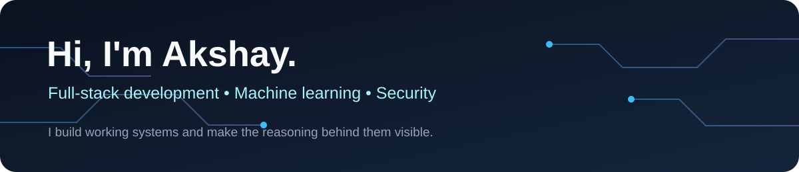

### Software engineering · Applied machine learning · Security

I build complete applications: from the data model and API to the interface, tests, and documentation.

[Explore my work](#selected-projects) · [See my approach](#how-i-build) · [Get in touch](#connect)

## About me

I'm Akshay, a developer interested in full-stack products, practical machine learning, and secure systems. I like projects where the user can inspect *why* a system produced a result, whether that means tracing the transactions behind an alert or seeing how a text classifier handles a review.

## Selected projects

### [RAG Guard Lab](https://github.com/Akshay-09-xd/rag-guard-lab) · Prompt injection test bench

A reproducible RAG security lab with 12 poisoned-document attacks, six benign controls, paired before/after runs, and a local results dashboard. It measures retrieval exposure, exact-marker attack success, answer utility, latency, and token usage. The included sample uses a clearly labeled simulator; the same harness supports a configured live model.

**Built with:** Python, retrieval ranking, security testing, evaluation design, JavaScript

[View methodology and code](https://github.com/Akshay-09-xd/rag-guard-lab#readme)

### [Sentinel AML](https://github.com/Akshay-09-xd/sentinel-aml) · Investigation workbench

A full-stack application for exploring transaction networks and managing evidence-backed anti-money-laundering cases. It detects time-ordered circular flows and concentrated fan-in patterns, shows the transfers behind each finding, and supports case notes, decisions, exports, and an audit history. The local demo runs with FastAPI, SQLite, NetworkX, and scikit-learn; Neo4j and local Ollama summaries are optional.

**Built with:** Python, FastAPI, SQLite, NetworkX, scikit-learn, Neo4j, JavaScript

[View code and setup](https://github.com/Akshay-09-xd/sentinel-aml#readme) · [See dashboard](https://github.com/Akshay-09-xd/sentinel-aml/blob/main/docs/dashboard.jpg)

### [Product review sentiment analysis](https://github.com/Akshay-09-xd/Sentiment-Analysis-on-Product-Reviews) · Text classification app

Classifies individual product reviews and CSV batches as positive or negative. Includes a Flask API and browser interface, downloadable batch results, a sentiment chart, and a Streamlit interface. The repository includes the trained XGBoost model and text preprocessing artifacts.

**Built with:** Python, Flask, Streamlit, XGBoost, NLP

[View code and setup](https://github.com/Akshay-09-xd/Sentiment-Analysis-on-Product-Reviews#readme)

### [Dynamic OTP authentication](https://github.com/Akshay-09-xd/ins) · Security project

A PIN-protected software token and authentication server using HMAC-SHA256 challenges. Codes expire, can be used once, and are checked with attempt limits; the project also includes a TOTP mode and 19 unit tests.

**Built with:** Python standard library, HMAC-SHA256, TOTP, unittest

[View implementation](https://github.com/Akshay-09-xd/ins#readme)

## What I work with

| Area | Tools and concepts shown in my projects |
| --- | --- |
| Backend and data | Python, FastAPI, Flask, REST APIs, SQLite, graph queries |
| Machine learning | scikit-learn, XGBoost, text preprocessing, anomaly detection |
| Frontend | JavaScript, HTML, CSS, Streamlit |
| Security and quality | Prompt injection testing, authentication, HMAC, encryption, audit trails, unit and API tests |

## How I build

- **Make results explainable.** Sentinel links each graph finding to exact transaction evidence; RAG Guard Lab separates retrieval exposure from attack success.
- **Build the whole workflow.** I work across storage, APIs, interfaces, and local setup so a project can be run and reviewed.
- **Document tradeoffs.** My project READMEs describe the implementation, how to test it, and where the demo's limits are.

## Connect

The best way to learn more about my work is to open a project above and inspect the code. You can also [contact me through GitHub](https://github.com/Akshay-09-xd).
